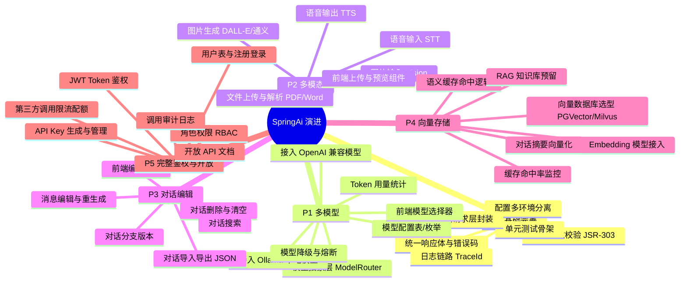

# SpringAi 项目演进路线图

> 生成时间：2026-08-23
> 当前基线：Spring Boot 4.1.0 / Spring AI 2.0.0 / DeepSeek 单模型 / MongoDB 记忆 / Redis 计数 / DeviceId 拦截鉴权

---

## 一、现状盘点

| 模块 | 现状 | 缺口 |
|------|------|------|
| 模型层 | 仅 DeepSeek，ChatClient 单例硬编码 | 无模型路由、无模型切换、无降级 |
| 对话 | 流式聊天 + MongoDB 记忆(20条窗口) + 自动标题 | 不可编辑、不可重生成、无分支、无导入导出 |
| 多模态 | 纯文本 | 不支持图片输入/输出、文件解析、语音 |
| 鉴权 | DeviceId Header 存在性校验 + Redis 次数限制 | 无用户体系、无登录、无 API Key、无权限分级 |
| 缓存 | 仅调用次数计数 | 无对话语义缓存、无 Prompt 缓存、无向量检索 |
| 工程化 | 有 Knife4j、全局异常、.env | 无统一响应体规范、无日志链路、无配置多环境、无测试 |
| 前端 | React+TS+Vite+Tailwind，聊天界面已跑通 | 无模型选择器、无多模态上传、无对话编辑 UI |

---

## 二、思维导图



---

## 三、分阶段路线图

### 阶段依赖关系

```
P0(基础) → P1(多模型) → P2(多模态)
                ↓
          P3(对话编辑)  ←  依赖 P1 的模型重生成
                ↓
          P4(向量存储)  ←  依赖 P3 的对话结构化
                ↓
          P5(鉴权开放)  ←  横切，可与 P1-P4 并行做用户体系
```

> P5 的用户表/JWT 可以提前到 P0 之后启动，因为它是横切关注点；API Key 开放部分建议最后做，等模型和对话能力稳定。

---

## 四、原子化任务清单

> 每个任务 = 一次可独立提交、可独立验证的最小工作单元。
> 复杂度：S(0.5天) / M(1-2天) / L(3-5天)

### P0 — 项目基础完善

| ID | 任务 | 验收标准 | 依赖 | 复杂度 |
|----|------|----------|------|--------|
| P0-01 | 统一响应体 `Result<T>` 与错误码枚举 | 所有 Controller 返回统一结构；错误码集中在 `ErrorCode` 枚举；全局异常处理器映射 | - | S |
| P0-02 | JSR-303 参数校验 | 所有请求 DTO 加 `@Valid` 校验注解；校验失败返回 400 + 字段错误信息 | P0-01 | S |
| P0-03 | 多环境配置分离 | `application-dev.yml` / `application-prod.yml`；`.env` 仅本地用；Mongo/Redis 地址走配置 | - | S |
| P0-04 | 日志链路 TraceId | `MDC` 注入 traceId；日志格式含 traceId；前端请求头 `X-Trace-Id` 透传 | - | S |
| P0-05 | 接口级日志 AOP | 入参/出参/耗时日志；敏感字段脱敏；生产环境可关 | P0-04 | S |
| P0-06 | 后端单元测试骨架 | `@SpringBootTest` 基类；Service 层 Mock 测试示例；CI 可跑 `mvn test` | - | M |
| P0-07 | 前端请求层统一封装 | `request.ts` 统一拦截器：token 注入、错误码处理、loading、重试；废弃散落的 fetch | - | S |
| P0-08 | 前端环境变量与 API 基址 | `.env.development` / `.env.production`；Vite 代理配置；API 基址不硬编码 | - | S |
| P0-09 | Docker Compose 本地依赖 | MongoDB + Redis 一键启动；`docker-compose.yml`；README 更新启动步骤 | - | S |

### P1 — 多模型选择

| ID | 任务 | 验收标准 | 依赖 | 复杂度 |
|----|------|----------|------|--------|
| P1-01 | 模型抽象接口 `AiModelService` | 定义 `chat()` / `streamChat()` / `getModelInfo()`；当前 DeepSeek 实现迁入 | P0-01 | M |
| P1-02 | 模型路由 `ModelRouter` | 根据请求参数 `model` 选择对应 `ChatModel` Bean；默认模型可配置；未知模型抛业务异常 | P1-01 | M |
| P1-03 | 模型配置枚举与元数据 | `ModelEnum` 含 modelKey、显示名、厂商、上下文窗口、是否支持视觉、是否支持工具调用 | P1-01 | S |
| P1-04 | 接入 OpenAI 兼容模型 | 通过 `spring-ai-starter-model-openai` 接入；配置 base-url 兼容 OneAPI/NewAPI 等中转 | P1-02 | M |
| P1-05 | 接入 Ollama 本地模型 | `spring-ai-starter-model-ollama`；本地模型列表拉取；健康检查 | P1-02 | M |
| P1-06 | 多模型 ChatClient 动态构建 | 不再单例 ChatClient；按模型 + 工具集动态构建；工具调用能力按模型支持度过滤 | P1-02 | L |
| P1-07 | 模型降级与熔断 | 主模型失败自动切备用模型；Resilience4j 或简单重试；降级日志可观测 | P1-04 | M |
| P1-08 | Token 用量统计中间件 | 每次调用记录 promptTokens / completionTokens / totalTokens / 模型 / 用户；存 MongoDB 或 Redis | P1-01 | M |
| P1-09 | 前端模型选择器 | 下拉组件展示可用模型；选择后请求携带 model；记忆当前选择；按对话维度记录模型 | P1-03 | S |
| P1-10 | 对话级模型绑定 | 对话创建时记录使用模型；后续消息沿用该模型；切换模型新建对话或提示 | P1-09, P0-01 | S |

### P2 — 多模态

| ID | 任务 | 验收标准 | 依赖 | 复杂度 |
|----|------|----------|------|--------|
| P2-01 | 图片输入(Vision)消息结构 | `Message` 实体支持 `imageUrls` 字段；`UserMessage` 构建多模态内容；仅视觉模型可用 | P1-03, P1-06 | M |
| P2-02 | 文件上传接口 | `MultipartFile` 上传；大小/类型限制；存本地或 OSS；返回 fileId/url | P0-02 | M |
| P2-03 | PDF/Word 文本解析 | Apache Tika 解析上传文件；提取纯文本；超长文本截断或分段 | P2-02 | M |
| P2-04 | 图片理解接口联调 | 上传图片 + 提问 → 视觉模型回答；前端图片预览 + 发送 | P2-01, P2-02 | M |
| P2-05 | 图片生成接入 | `spring-ai-starter-image-openai` 或通义万相；`/api/image/generate` 返回图片 url | P1-02 | M |
| P2-06 | 语音输入 STT | Whisper API 或本地；音频上传转文字；自动填入输入框 | P2-02 | M |
| P2-07 | 语音输出 TTS | OpenAI TTS 或 Edge TTS；返回音频流；前端播放控件 | P1-02 | M |
| P2-08 | 前端多模态上传组件 | 图片/文件/语音统一上传按钮；预览缩略图；上传进度；删除已选 | P2-02 | M |

### P3 — 对话修改

| ID | 任务 | 验收标准 | 依赖 | 复杂度 |
|----|------|----------|------|--------|
| P3-01 | 消息编辑接口 | `PUT /api/messages/{id}` 修改内容；编辑后该消息之后的回复标记为"过时" | P0-01 | S |
| P3-02 | 重生成(Regenerate) | 对某条 AI 回复重新生成；基于该消息之前的上下文；旧回复保留可切换 | P1-06, P3-01 | M |
| P3-03 | 对话分支版本 | 每次编辑/重生成创建 branch；`Message` 增加 `branchId` / `parentId`；前端可切换分支 | P3-02 | L |
| P3-04 | 删除单条消息 | `DELETE /api/messages/{id}`；删除后后续记忆需重建或截断 | P0-01 | S |
| P3-05 | 清空/删除对话 | `DELETE /api/conversations/{id}`；级联删除消息和记忆；前端确认弹窗 | P0-01 | S |
| P3-06 | 对话导出 JSON | `GET /api/conversations/{id}/export` 下载完整对话 JSON；含消息、模型、时间 | - | S |
| P3-07 | 对话导入 JSON | `POST /api/conversations/import` 上传 JSON 还原对话；校验格式；冲突处理 | P3-06 | M |
| P3-08 | 对话搜索 | 按标题/消息内容模糊搜索；MongoDB 文本索引；前端搜索框 | - | M |
| P3-09 | 前端消息编辑交互 | 双击/hover 出现编辑按钮；编辑态 textarea；保存后触发重生成提示 | P3-01 | M |
| P3-10 | 前端分支切换 UI | 分支列表侧边栏；切换分支后消息列表更新；当前分支高亮 | P3-03 | M |

### P4 — 向量存储与语义缓存

| ID | 任务 | 验收标准 | 依赖 | 复杂度 |
|----|------|----------|------|--------|
| P4-01 | 向量数据库选型与部署 | 确定 PGVector(轻量) 或 Milvus(大规模)；Docker Compose 加入；健康检查 | P0-09 | M |
| P4-02 | Embedding 模型接入 | `spring-ai-starter-model-embedding-openai` 或本地 BGE；`EmbeddingModel` Bean | P1-02 | M |
| P4-03 | 向量存储配置 | `VectorStore` 配置；集合/表初始化；Spring AI VectorStore API 对接 | P4-01, P4-02 | M |
| P4-04 | 对话摘要生成 | 每 N 轮或对话结束时用 LLM 生成摘要；摘要 + conversationId 存入向量库 | P4-03 | M |
| P4-05 | 语义缓存命中逻辑 | 新问题先向量化检索历史对话；相似度 > 阈值则直接返回缓存答案；否则走 LLM | P4-04 | L |
| P4-06 | 缓存写入与失效 | LLM 回答后异步写入向量缓存；对话编辑/删除时清除对应缓存；TTL 策略 | P4-05 | M |
| P4-07 | 缓存命中率监控 | Actuator 端点暴露命中率；日志记录命中/未命中；前端不展示（内部指标） | P4-05 | S |
| P4-08 | RAG 知识库预留接口 | `KnowledgeService` 接口定义；文档切片+向量化 pipeline；查询时 topK 召回（本期不做 UI） | P4-03 | L |

### P5 — 完整用户鉴权与 API 开放

| ID | 任务 | 验收标准 | 依赖 | 复杂度 |
|----|------|----------|------|--------|
| P5-01 | 用户实体与注册 | `User` 表：id/username/password(BCrypt)/email/createdAt；注册接口；用户名唯一 | P0-01 | M |
| P5-02 | 登录与 JWT 签发 | `/api/auth/login` 返回 accessToken + refreshToken；JWT 含 userId/角色；过期时间可配 | P5-01 | M |
| P5-03 | JWT 鉴权过滤器 | 替换 DeviceIdInterceptor；`Bearer Token` 解析；未登录返回 401；白名单路径 | P5-02 | M |
| P5-04 | 数据隔离 | 对话/消息/调用记录全部关联 userId；查询强制过滤；越权访问返回 403 | P5-03 | M |
| P5-05 | 角色权限 RBAC | `Role` 枚举(USER/ADMIN)；`@PreAuthorize` 注解；管理员接口隔离 | P5-03 | S |
| P5-06 | API Key 实体与生成 | `ApiKey` 表：key(前缀明文+哈希存储)/name/scopes/expiresAt/lastUsedAt；用户可创建多个 | P5-01 | M |
| P5-07 | API Key 鉴权 | `X-API-Key` Header 解析；与 JWT 过滤器共存；Key 无效/过期返回 401 | P5-06 | M |
| P5-08 | 第三方调用限流配额 | 按 API Key 维度限流(Redis 滑动窗口)；配额(qpm/每日总额)可配；超限返回 429 | P5-07, P1-08 | M |
| P5-09 | 调用审计日志 | 每次 API 调用记录：apiKeyId/endpoint/model/tokens/ip/timestamp/耗时；可查询 | P5-07 | M |
| P5-10 | 开放 API 兼容层 | `/v1/chat/completions` 兼容 OpenAI 格式；支持流式；第三方可直接用 OpenAI SDK 调用 | P5-07, P1-06 | L |
| P5-11 | API Key 管理前端 | 用户中心：创建/查看/撤销 API Key；显示密钥(仅创建时)；使用量统计 | P5-06 | M |
| P5-12 | 前端登录注册页面 | 登录/注册表单；token 存 localStorage；路由守卫；401 自动跳登录 | P5-02 | M |

---

## 五、建议执行顺序（迭代视角）

### Sprint 1（1-2 周）：P0 基础 + P5-01~03 用户体系
- 先把工程化底座打牢，同时引入用户登录
- 产出：可登录、有 traceId、有统一响应体的版本

### Sprint 2（1-2 周）：P1 多模型
- 模型抽象 + OpenAI 兼容 + Ollama + 前端选择器
- 产出：用户可切换模型聊天

### Sprint 3（1-2 周）：P3 对话编辑
- 编辑/重生成/删除/导出导入
- 产出：对话可编辑、可回溯

### Sprint 4（2-3 周）：P2 多模态
- 图片理解 + 文件解析 + 图片生成
- 产出：支持图文混合输入

### Sprint 5（2-3 周）：P4 向量存储
- 向量库 + Embedding + 语义缓存
- 产出：重复问题命中缓存，token 下降

### Sprint 6（2-3 周）：P5 API 开放
- API Key + 限流 + 审计 + OpenAI 兼容层
- 产出：第三方可通过 API Key 调用

---

## 六、风险与注意事项

1. **Spring AI 2.0 版本较新**：部分 starter（如 image、ollama）的 API 可能变动，接入时先跑通最小 demo 再整合。
2. **多模型 ChatClient 动态构建**：当前是单例 Bean，改造成原型模式或 Builder 模式时注意工具注入的作用域。
3. **向量缓存语义匹配**：相似度阈值需要调优，过低会误命中，过高等于没缓存；建议先灰度。
4. **API Key 安全**：密钥只在创建时返回明文，数据库存哈希（SHA-256），前缀用于识别。
5. **对话分支复杂度**：P3-03 是整个 P3 最重的任务，如果时间紧可以先不做分支，只做"编辑后从该点重生成、丢弃后续"的简化版。
6. **MongoDB 对话记忆与自定义对话表**：当前 Spring AI 的 MongoChatMemoryRepository 和你自己的 Chat 集合是两套，P3 编辑时需要注意同步或择一为主。
